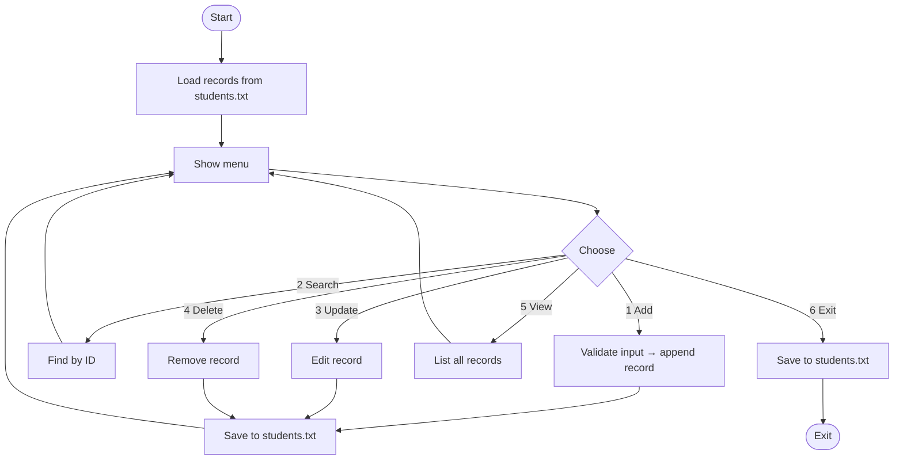

# 🎓 Student Management System (C++)

[](https://pawanriko.github.io/Student-Management-System/)


[](LICENSE)

[](https://skillicons.dev)

A robust console-based Student Management System built using C++. This project allows users to manage student records efficiently through a simple menu-driven interface while demonstrating core programming concepts such as Object-Oriented Programming, File Handling, Data Validation, and CRUD Operations.

**Live (web version):** [pawanriko.github.io/Student-Management-System/](https://pawanriko.github.io/Student-Management-System/)

## How it works


---

## 🚀 Features

### Student Management

* Add new students
* Search students by ID
* Update existing student records
* Delete student records
* View all student records

### Data Validation

* Prevents duplicate student IDs
* Validates numeric inputs
* Restricts age between 1 and 120
* Rejects empty names and courses
* Handles invalid user input gracefully

### File Persistence

* Stores records in a local file (`students.txt`)
* Automatically saves changes
* Loads records on startup

### Error Handling

* Detects malformed records
* Uses exception handling to prevent crashes
* Skips corrupted data safely

---

## 🛠 Technologies Used

[](https://skillicons.dev)

* C++
* STL (Vector, Algorithm, String)
* File Handling (`fstream`)
* Exception Handling
* Object-Oriented Programming (OOP)

---

## 📂 Project Structure

```text
Student-Management-System/
│
├── StudentManagementSystem.cpp
├── students.txt
├── index.html
├── README.md
└── LICENSE
```

---

## 📋 Sample Menu

```text
===============================
   STUDENT MANAGEMENT SYSTEM
===============================
1. Add Student
2. Search Student
3. Update Student
4. Delete Student
5. View All Students
6. Exit
```

---

## 💾 Data Storage Format

Student records are stored in a text file using comma-separated values:

```text
ID, Name, Age, Course
```

Example:

```text
101, John Doe,20, Computer Science
102, Sarah Khan,19, Information Technology
103, Rahul Sharma,21, Electronics
```

---

## 📚 Concepts Demonstrated

* Classes and Objects
* Encapsulation
* Functions and Modular Programming
* STL Vector Container
* Sorting Algorithms
* Searching Techniques
* File Handling
* Exception Handling
* Input Validation
* CRUD Operations

---

## 🔧 How to Compile and Run

### Compile

```bash
g++ StudentManagementSystem.cpp -o sms
```

### Run

```bash
./sms
```

---


## 🎯 Future Improvements

* Student Attendance Tracking
* GPA Management
* Course Management System
* Database Integration (SQLite/MySQL)
* GUI Version
* Export Records to CSV

---

## 👨‍💻 Author

**Pawan**

Built as a portfolio project to practice C++ programming, file handling, input validation, and software design fundamentals.

---

## ⭐ If you found this project useful, consider giving it a star.
